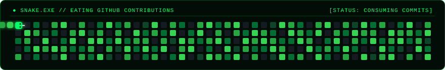

<!-- ======================================================== -->
<!-- 🚀 AMIT KUMAR PRADHAN // GITHUB PROFILE README            -->
<!-- AESTHETICS: MATRIX NEON GREEN // CYBER HUD // ANIMATED    -->
<!-- ======================================================== -->

  <!-- 🌌 TOP ANIMATED WAVE HEADER (GREEN GRADIENT) -->
  

  <!-- ⚡ ANIMATED MATRIX DIGITAL RAIN BANNER -->
  

   

  <!-- 🟢 DYNAMIC TYPING SVG ANIMATION -->
  

   

  <!-- 🛡️ GLOWING HUD BADGES ROW -->
  

    
    &nbsp;
    
    &nbsp;
    
    &nbsp;
    
  

  <!-- ⚡ ANIMATED LASER DIVIDER -->
  

 

<!-- ======================================================== -->
<!-- 🖥️ CYBER HUD & ABOUT ME CONSOLE                          -->
<!-- ======================================================== -->

  

 

<table width="100%" align="center">
  <tr>
    <td width="58%" valign="top" style="background:#02140a; border: 1px solid #00FF66; border-radius: 10px; padding: 16px;">
      <h3 style="color: #00FF66; margin-top: 0;">
        ⚡ <code>$ cat about_amit.sh</code>
      </h3>
      

        Hey there! I'm <b>Amit Kumar Pradhan</b>, an aspiring <b>AI Developer</b> and <b>B.Tech Computer Science student</b> based in <b>Bhubaneswar, India</b>.
      

      

        Driven by curiosity, I specialize in engineering autonomous intelligent systems, high-performance algorithms, and creative web applications with captivating motion graphics. I believe great software bridges mathematical elegance with mind-blowing aesthetics.
      

      <ul style="color: #86efac; font-size: 13px; line-height: 1.8;">
        <li>🔭 <b>Currently Building:</b> AI agents & interactive, high-impact web apps</li>
        <li>🧠 <b>Deep Diving Into:</b> Large Language Models, Neural Nets & Vector Search</li>
        <li>💡 <b>Philosophy:</b> <i>"Code with precision, design with elegance, deploy with confidence."</i></li>
        <li>⚡ <b>Superpower:</b> Quick learner who turns wild concepts into functional code fast</li>
      </ul>
    </td>
    <td width="42%" valign="top" style="background:#02140a; border: 1px solid #00FF66; border-radius: 10px; padding: 16px;">
      <h3 style="color: #00FF66; margin-top: 0;">
        📊 <code>$ status --verbose</code>
      </h3>
      <table width="100%" style="color: #cbd5e1; font-size: 12.5px; border-collapse: collapse;">
        <tr>
          <td style="color:#6ee7b7; padding: 4px 0;"><b>Role</b></td>
          <td style="text-align:right; color:#00FF66;">AI &amp; Creative Developer</td>
        </tr>
        <tr>
          <td style="color:#6ee7b7; padding: 4px 0;"><b>Degree</b></td>
          <td style="text-align:right;">B.Tech Computer Science</td>
        </tr>
        <tr>
          <td style="color:#6ee7b7; padding: 4px 0;"><b>Base Location</b></td>
          <td style="text-align:right;">Bhubaneswar, Odisha, IN</td>
        </tr>
        <tr>
          <td style="color:#6ee7b7; padding: 4px 0;"><b>Primary Stack</b></td>
          <td style="text-align:right; color:#00FF66;">Python • C++ • AI • Web</td>
        </tr>
        <tr>
          <td style="color:#6ee7b7; padding: 4px 0;"><b>Portfolio</b></td>
          <td style="text-align:right;"><a href="https://amitkupradhan323-glitch.github.io/my-portfolio/" style="color:#00FF66;">Live Site ↗</a></td>
        </tr>
        <tr>
          <td style="color:#6ee7b7; padding: 4px 0;"><b>Availability</b></td>
          <td style="text-align:right; color:#86efac;">● Open for Projects</td>
        </tr>
      </table>
       
      

        
      

    </td>
  </tr>
</table>

 

  

 

<!-- ======================================================== -->
<!-- 🛠️ TECH STACK ARSENAL                                   -->
<!-- ======================================================== -->

  
  
    

  <!-- DYNAMIC SKILL ICONS (DARK MATRIX PALETTE) -->
  

    

  <!-- CATEGORIZED GREEN BADGES TABLE -->
  <table width="100%">
    <tr>
      <td width="22%" align="center" style="background:#02140a; border: 1px solid #00FF66; border-radius: 8px;">
        <b style="color: #00FF66;">💻 Languages</b>
      </td>
      <td style="background:#02140a; border: 1px solid #00FF66; border-radius: 8px; padding: 8px;">
        
        
        
        
        
        
        
        
        
      </td>
    </tr>
    <tr>
      <td width="22%" align="center" style="background:#02140a; border: 1px solid #00FF66; border-radius: 8px;">
        <b style="color: #00FF66;">🧠 AI &amp; Data Science</b>
      </td>
      <td style="background:#02140a; border: 1px solid #00FF66; border-radius: 8px; padding: 8px;">
        
        
        
        
        
        
        
      </td>
    </tr>
    <tr>
      <td width="22%" align="center" style="background:#02140a; border: 1px solid #00FF66; border-radius: 8px;">
        <b style="color: #00FF66;">🌐 Frontend &amp; Motion</b>
      </td>
      <td style="background:#02140a; border: 1px solid #00FF66; border-radius: 8px; padding: 8px;">
        
        
        
        
        
      </td>
    </tr>
    <tr>
      <td width="22%" align="center" style="background:#02140a; border: 1px solid #00FF66; border-radius: 8px;">
        <b style="color: #00FF66;">⚙️ Backend &amp; DB</b>
      </td>
      <td style="background:#02140a; border: 1px solid #00FF66; border-radius: 8px; padding: 8px;">
        
        
        
        
        
      </td>
    </tr>
    <tr>
      <td width="22%" align="center" style="background:#02140a; border: 1px solid #00FF66; border-radius: 8px;">
        <b style="color: #00FF66;">🛠️ Dev Tools &amp; OS</b>
      </td>
      <td style="background:#02140a; border: 1px solid #00FF66; border-radius: 8px; padding: 8px;">
        
        
        
        
        
        
        
      </td>
    </tr>
  </table>

   

  

 

<!-- ======================================================== -->
<!-- 🐍 CONTRIBUTION SNAKE GAME ANIMATION                     -->
<!-- ======================================================== -->

  <picture>
    <source media="(prefers-color-scheme: dark)" srcset="https://raw.githubusercontent.com/amitkupradhan323-glitch/amitkupradhan323-glitch/output/github-contribution-grid-snake-dark.svg">
    <source media="(prefers-color-scheme: light)" srcset="https://raw.githubusercontent.com/amitkupradhan323-glitch/amitkupradhan323-glitch/output/github-contribution-grid-snake.svg">
    
  </picture>

 

<!-- ======================================================== -->
<!-- 📊 GITHUB TELEMETRY & STATS MATRIX                       -->
<!-- ======================================================== -->

  
  
    

  <table border="0" align="center">
    <tr align="center">
      <td>
        
      </td>
      <td>
        
      </td>
    </tr>
    <tr align="center">
      <td colspan="2">
         
        
      </td>
    </tr>
  </table>

   

  

 

<!-- ======================================================== -->
<!-- 🚀 FEATURED WORK & HIGHLIGHT                             -->
<!-- ======================================================== -->

  <table width="100%">
    <tr>
      <td style="background:#02140a; border: 1.5px solid #00FF66; border-radius: 12px; padding: 20px;">
        <table width="100%">
          <tr>
            <td>
              <h3 style="color: #00FF66; margin: 0;">
                🌟 Featured Showcase: Creative Portfolio Website
              </h3>
              

                Interactive portfolio engineered with <b>Tailwind CSS</b>, <b>GSAP motion engine</b>, 3D perspective parallax interactions, and responsive design.
              

              

                
                
                
                
              

            </td>
            <td align="right" valign="middle" width="220">
              
                
              
            </td>
          </tr>
        </table>
      </td>
    </tr>
  </table>

   

  

 

<!-- ======================================================== -->
<!-- 📡 CONNECT & TRANSMISSION CHANNELS                       -->
<!-- ======================================================== -->

  

    

  

    <i>Have an idea, exciting project, or looking to collaborate? Drop me a line!</i>
  

  

    
    &nbsp;
    
    &nbsp;
    
  

   

  <!-- 🌌 BOTTOM ANIMATED WAVE FOOTER (GREEN GRADIENT) -->
  

  

    ⚡ <code>ENGINEERED WITH PASSION &bull; MATRIX GREEN THEME &bull; &copy; 2026 AMIT KUMAR PRADHAN</code> ⚡
  

